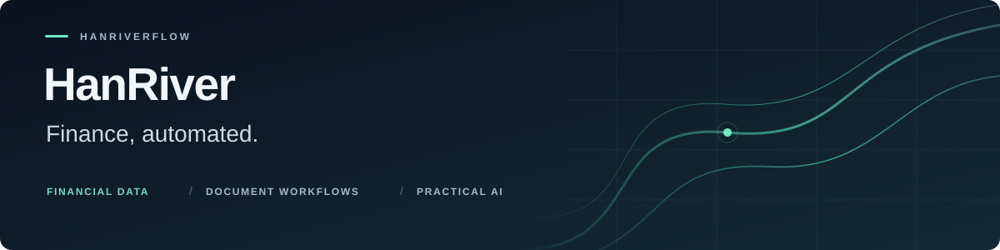

I build practical tools that connect **financial data, document automation, and AI-assisted workflows**.

금융 데이터를 읽고, 반복되는 문서 작업을 줄이고, AI를 실제 업무 도구로 연결합니다.  
Based in **Yeouido, Seoul**.

[Explore repositories](https://github.com/Hanriverflow?tab=repositories) · [Rate dashboard](https://hanriverflow.github.io/rate-gap/) · [HWPX guide](https://hanriverflow.github.io/HWPX_wiz/)

## Selected projects

<table>
<tr>
<td width="50%" valign="top">
<h3><a href="https://github.com/Hanriverflow/Dart_xbrl_FS_pipeline">DART XBRL Pipeline</a></h3>

OpenDART filings into structured financial statements, note tables, and analysis workflows.

<code>Python</code> <code>OpenDART</code> <code>XBRL</code>

</td>
<td width="50%" valign="top">
<h3><a href="https://github.com/Hanriverflow/IB_report_formatter">IB Report Formatter</a></h3>

Markdown into editable Word reports for investment banking and Korean business documents.

<code>Python</code> <code>Markdown</code> <code>DOCX</code>

</td>
</tr>
<tr>
<td width="50%" valign="top">
<h3><a href="https://github.com/Hanriverflow/rate-gap">Rate Gap</a></h3>

A reference dashboard for KDB base rates and bond valuation yield gaps.

<a href="https://hanriverflow.github.io/rate-gap/">Open dashboard &rarr;</a>

</td>
<td width="50%" valign="top">
<h3><a href="https://github.com/Hanriverflow/HWPX_wiz">HWPX Wiz</a></h3>

A Windows integration layer for Korean document workflows, built around Kordoc and hwpx-skill.

<a href="https://hanriverflow.github.io/HWPX_wiz/">Read the guide &rarr;</a>

</td>
</tr>
</table>

### Beyond finance

[**RealtimeSTT Voice Recorder**](https://github.com/Hanriverflow/RealtimeSTT_UV_managed) · A Windows tray app for voice-to-text input and audio-file transcription, powered by RealtimeSTT and faster-whisper.

### Working toolkit

`Python` · `PowerShell` · `uv` · `OpenDART / XBRL` · `Markdown / DOCX / HWPX`

---

Built with open source. HWPX Wiz integrates [Kordoc](https://github.com/chrisryugj/kordoc) and [hwpx-skill](https://github.com/jkf87/hwpx-skill). Project capabilities and setup requirements are documented in each repository. Rate Gap is a reference tool, not an investment recommendation.
